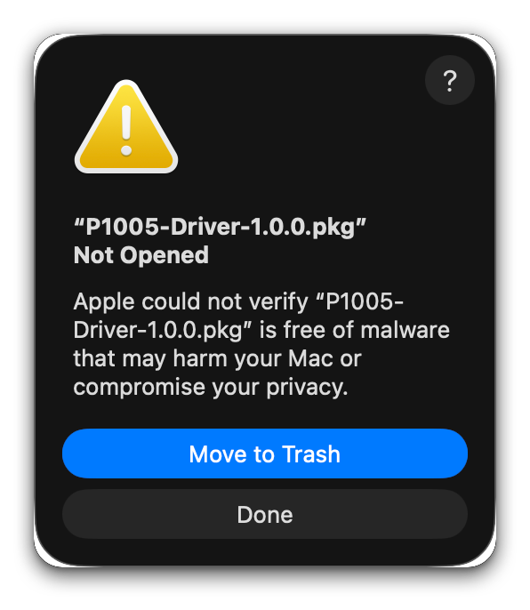
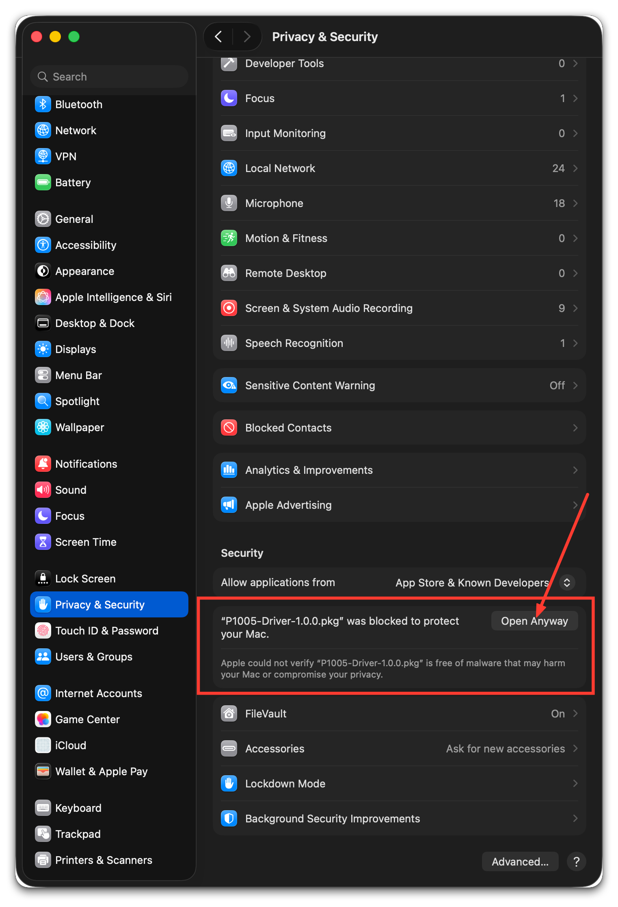
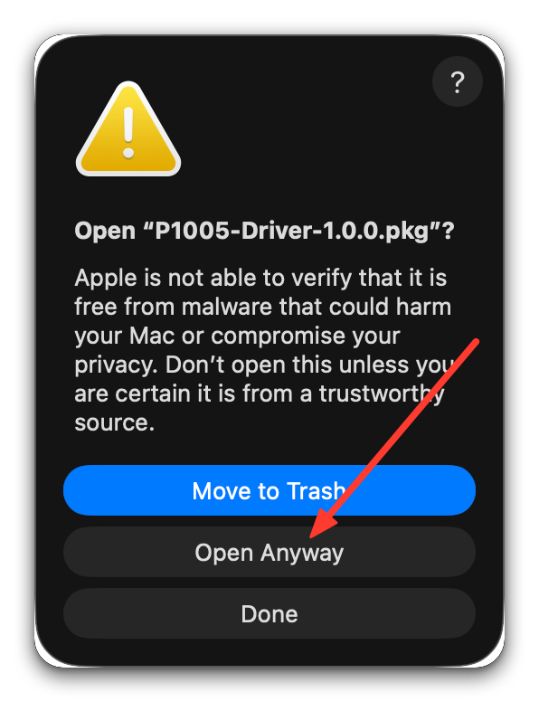
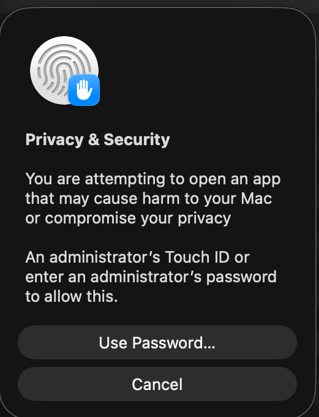
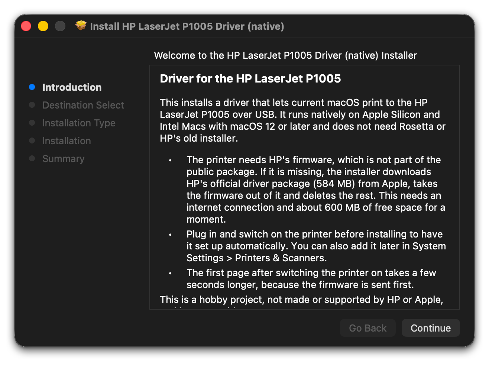
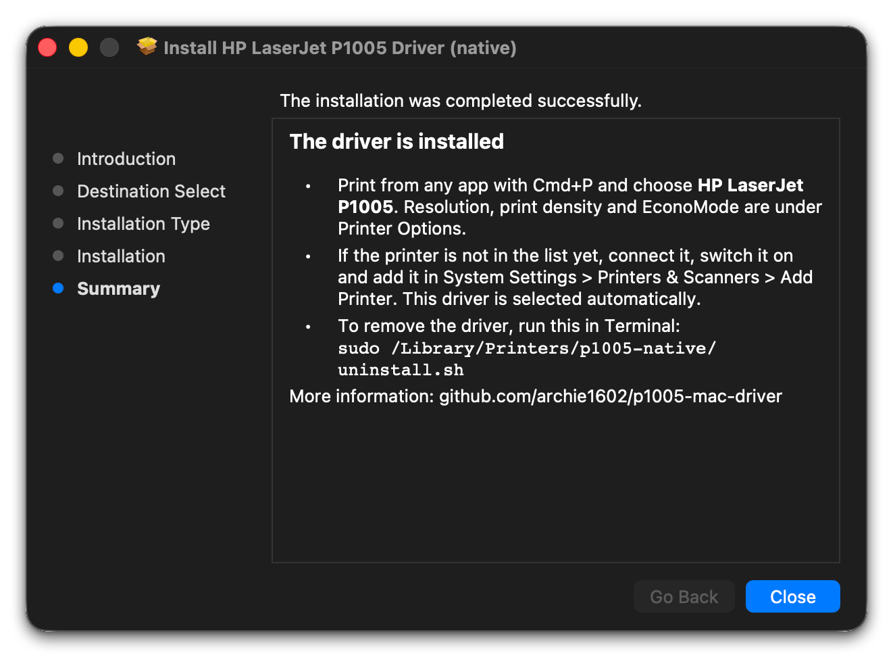
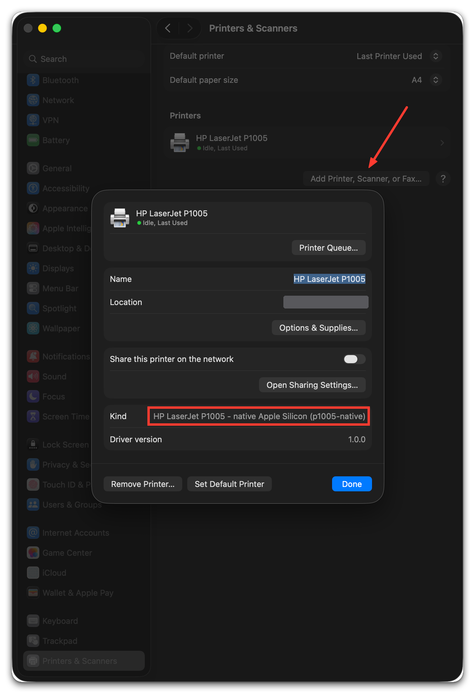
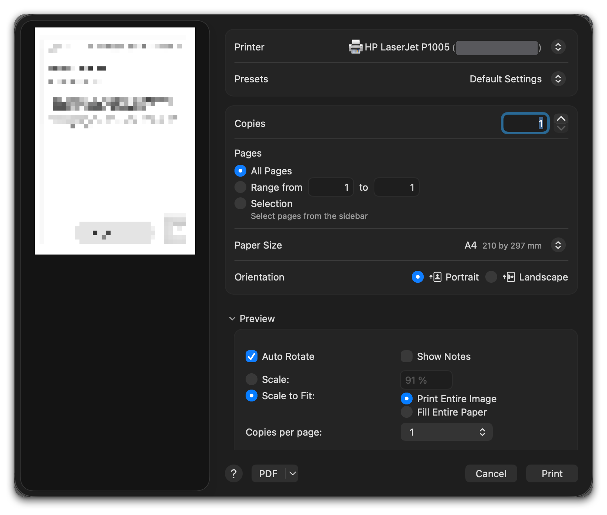

# Installing the driver, step by step

These are screenshots from my own install on a MacBook with Apple Silicon
and macOS 26. I removed everything I had set up while building the driver
and installed it from the Releases page, the same way anyone else would. The
installer itself took about a minute and a half, most of it spent downloading
the firmware, and my test page printed fine right after.

Before you start, plug the printer into your Mac with USB, switch it on and
make sure you are connected to the internet.

## 1. Download the package

Go to the [Releases page](https://github.com/archie1602/p1005-mac-driver/releases/latest)
and download `P1005-Driver-1.0.0.pkg`. It is only about 70 KB.

## 2. macOS blocks it the first time

Double click the package. macOS refuses to open it and says it could not
verify it. That is expected: I don't pay Apple for a developer certificate,
so the package isn't signed. Click **Done**, not Move to Trash.



## 3. Allow it in Privacy & Security

Open **System Settings > Privacy & Security** and scroll down to the Security
section. There is a note saying the package was blocked to protect your Mac.
Click **Open Anyway**.



The button only shows up for about an hour after you tried to open the
package. If it's not there, double click the package again and come back.

## 4. Confirm

macOS asks one more time. Click **Open Anyway**.



Then confirm with Touch ID or your password.



## 5. Run the installer

The installer opens. Click **Continue** and then **Install**. macOS asks for
your password again, this time to install the files.



While the installer says it is running package scripts, it downloads HP's
official driver package from Apple (584 MB), takes the firmware out of it and
deletes the rest. For me that took just under a minute. Let it finish.

## 6. Done



The installer also switches your printer over to the new driver. If the
printer was already set up with another driver before, that one is saved in
`/Library/Printers/p1005-native/backup/` and comes back if you uninstall.

## 7. Check the printer

Open **System Settings > Printers & Scanners** and click on HP LaserJet
P1005. Next to Kind it should say
`HP LaserJet P1005 - native Apple Silicon (p1005-native)`, with driver
version 1.0.0.

If your printer is not in the list at all, click **Add Printer, Scanner, or
Fax...** and choose the HP LaserJet P1005. macOS picks this driver by itself.



## 8. Print

Open any document, press Cmd+P, choose **HP LaserJet P1005** and click
**Print**. Paper size, resolution, print density and EconoMode are all in the
print dialog.



If you just switched the printer on, the first page takes a few seconds
longer, because the driver sends the firmware to the printer first. After
that it prints like it always did.

## If something goes wrong

**The installer says the installation failed.** Almost always this means the
firmware download did not work. Check your internet connection and run the
package again. In the installer, Window > Installer Log shows what happened.

**Nothing comes out of the printer.** Switch it off and on and print again.
There are more tips in the Troubleshooting section of the
[README](../README.md#troubleshooting).

## Removing the driver

Open Terminal and run

```sh
sudo /Library/Printers/p1005-native/uninstall.sh
```

It puts back the driver your printer had before, or removes the printer if
there wasn't one, and deletes everything the installer added.
